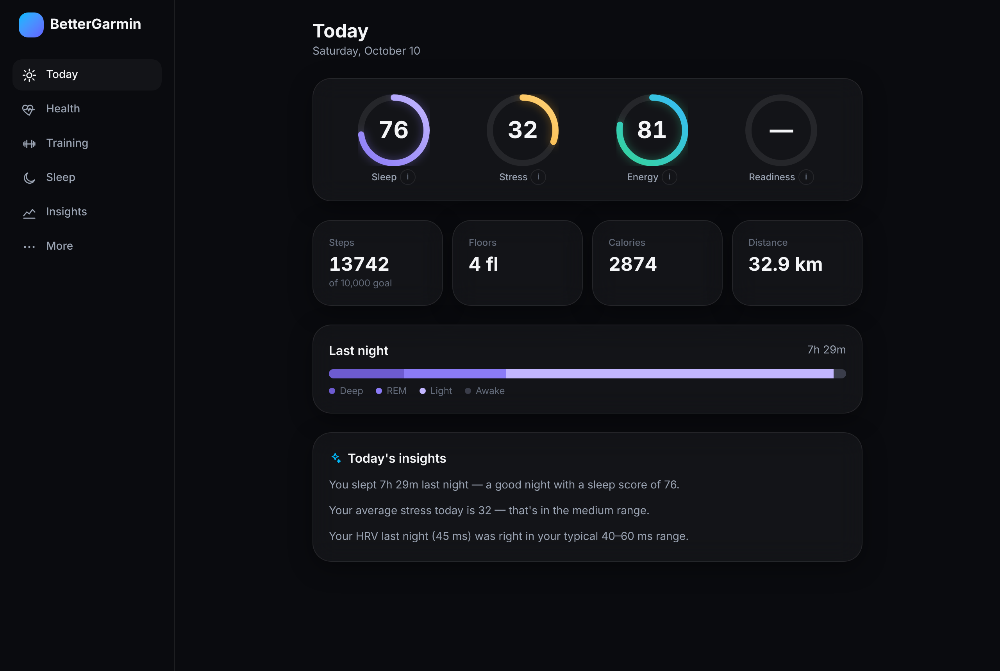
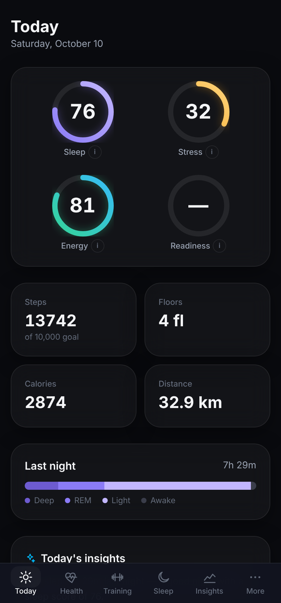
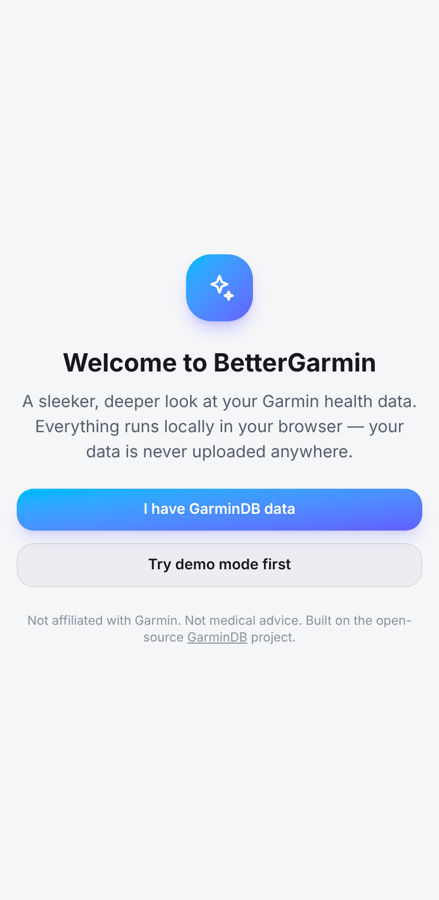
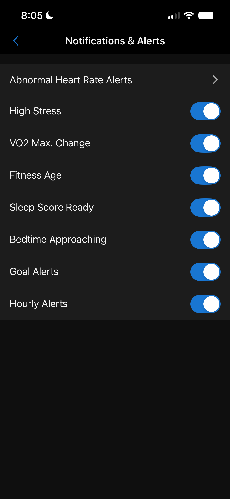

# BetterGarmin

A sleeker, deeper dashboard for your Garmin health data, built on the
open-source [GarminDB](https://github.com/tcgoetz/GarminDB) project. It runs
entirely in your browser as an installable app. Nothing is uploaded unless
you turn on the optional [cloud sync](docs/cloud-sync.md).

Not affiliated with Garmin. Not medical advice.

> **Device support: Garmin CIRQA only, for now.** Direct Bluetooth sync,
> band file decoding and the band-specific features are built and tested for
> the Garmin **CIRQA Smart Band** only. Other Garmin watches and bands aren't
> supported yet. Their data may still appear through the optional GarminDB
> cloud sync, but nothing is promised for them.

<p>
  
</p>
<p>
  
  
</p>

## Features

- **Today**: a readiness score, Energy Reserve curve, sleep and stress bars, steps and active calories, and plain-language insights.
- **Health, Sleep, Training**: trends, records and activity details, including maps.
- **Strength training**: import workouts from **Element 26**. Each workout gets a heart-rate timeline lined up with your sets, recovery between sets, a correction tool and workout comparison.
- **Insights**: findings that link training with sleep, resting HR and HRV, with sample sizes and evidence levels instead of overconfident claims. Also history charts, personal experiments, and an optional Gemini assistant that uses your own API key.
- **Live heart rate**: straight from your watch over Bluetooth (Chrome/Edge; on iPhone, Safari with the beacio extension or Bluefy).
- **Sync straight from the band**: **Sync now** downloads stress, energy, heart rate, steps, sleep and activities from your Garmin band over Bluetooth. No Garmin Connect or Garmin cloud needed.
- **Cloud sync** (optional backup): a scheduled job pulls from Garmin every 30 minutes, used when the band isn't nearby.
- **Intelligence** (Insights → Intelligence): recovery momentum, an experimental illness radar, sleep timing and regularity, sleep debt and long-term trends, each compared with your own baseline, with its evidence and limits shown. See [docs/intelligence.md](docs/intelligence.md).
- **Power tools**: units, goals, CSV export and an SQL console.

## Quick start

| I want to… | Do this |
| --- | --- |
| Look around | Open the app and tap **Try demo mode**. |
| Use my data privately | Run GarminDB on your computer and drop the `.db` files in. See [Getting your data](#getting-your-data). |
| Sync from my band | Open the app in Bluefy (or Chrome/Edge) and tap **Sync now**. See [Syncing from the band](#syncing-from-the-band). |
| Have a cloud backup | [Fork it and host your own copy](docs/self-hosting.md), then set up [cloud sync](docs/cloud-sync.md). |
| Fix a problem | See [troubleshooting](docs/troubleshooting.md). |

## Recommended setup (iPhone)

Not sure what to pick? Do these and you're done. Each one links to the
details and the alternatives.

| Choice | ⭐ Recommended | Alternatives |
| --- | --- | --- |
| **How to open the app** | A **Safari tab** with the beacio extension and the [Compact tab layout](#making-safari-look-like-an-app): live heart rate works and the address bar shrinks out of the way | Safari **Home Screen app** (always full screen, no live heart rate), [Bluefy or WebBLE](#choosing-a-browser-iphone) |
| **Live heart rate over Bluetooth** | The **beacio** Safari extension in a Safari tab (the Home Screen app's **Open in Safari** button takes you there) | [Bluefy](#choosing-a-browser-iphone) |
| **Getting your data in** | [**Sync now** straight from the band](#syncing-from-the-band) | [Cloud sync](docs/cloud-sync.md) backup, or [drop in GarminDB files](#getting-your-data) |
| **Look** | The **Glacier** preset (default) | 7 other presets in Customize |
| **Clock and units** | Whatever your phone uses (default) | More → Clock / Units |

### Choosing a browser (iPhone)

Live heart rate needs Web Bluetooth, which Safari, Chrome and Edge on iPhone
don't have. Everything else (cloud sync, charts, Sync now) works in any browser.

| Option | Full screen | Live heart rate | Notes |
| --- | --- | --- | --- |
| ⭐ **Safari tab + beacio extension** | Nearly: the address bar shrinks to a small pill, or hide it | ✅ | Best overall. See [Making Safari look like an app](#making-safari-look-like-an-app). |
| **Safari Home Screen app** | ✅ Always | ❌ (extensions don't run in Home Screen apps; it has an **Open in Safari** button) | Good if you rarely need live heart rate |
| **Bluefy** | Only from Bluefy's own menu (the app can't turn it on) | ✅ | Easiest if you want live heart rate everywhere |
| **WebBLE** | Not confirmed | ✅ | Similar to Bluefy |

**Setting up Safari + beacio (recommended)**

1. Install **[beacio](https://apps.apple.com/tt/app/ioswebble/id6761301368)**
   (listed as "iOSWebBLE", "Web Bluetooth for Safari") from the App Store and
   open it once. It's from an independent developer, so only allow it on
   BetterGarmin's site.
2. **Settings → Apps → Safari → Extensions → beacio**: turn it on and allow
   it only on your BetterGarmin address (for example
   `yourname.github.io`), not All Websites.
3. Open BetterGarmin in a normal Safari tab and tap **Connect** on the heart
   rate card (turn on Broadcast Heart Rate on the watch first). If your watch
   connects, the extension works.
4. Tap **Share → Add to Home Screen** and use the new icon every day: it's
   always full screen. iOS doesn't run Safari extensions inside Home Screen
   apps, so for live heart rate tap **Open in Safari** on the heart rate card.
   It opens BetterGarmin in a Safari tab, where beacio works and **Connect**
   appears.

#### Making Safari look like an app

Safari on iPhone doesn't let websites go fullscreen (Apple only allows that for
videos), but you can get close:

1. **Compact tab layout:** Settings → Apps → Safari → **Tabs** → **Compact**.
   The address bar shrinks to a thin strip as soon as you scroll.
2. **Hide Toolbar:** tap the page menu at the left of the address bar →
   **Hide Toolbar**. Tap the top of the screen to bring it back.
3. **Toolbar colours:** BetterGarmin asks Safari to tint its bars to match the
   top of the screen. Older Safari versions follow this; the floating address
   bar in the newest iOS mostly picks its own colour, so there it may still
   show as a dark strip. Steps 1 and 2 are what really get it out of the way.

The Home Screen app keeps its own storage, so connect cloud sync once more
inside it (Worker address and access token).

## Syncing from the band

BetterGarmin can connect straight to a Garmin **CIRQA** band over Bluetooth
(Bluefy on iPhone, or Chrome/Edge), without Garmin Connect or Garmin's cloud.

- **Workouts:** starting a Strength activity on the band from a workout is
  planned for **Element 26**, not BetterGarmin. The tested protocol is in
  [docs/band-protocol.md](docs/band-protocol.md).
- **Test band alert:** makes the band buzz (Find My Watch). It's a test, not a
  custom vibration or an alarm.
- **Sync now** (Today, More, and the band card) is the main way data gets
  in. It connects to the band, downloads new files, checks each one with
  Garmin's FIT SDK and imports stress, energy (Body Battery), heart rate,
  steps, sleep stages and sleep score, plus activities. Files are never
  deleted or changed on the band, and nothing is imported twice. If the band
  can't be reached and cloud sync is set up, Sync now falls back to the cloud
  copy. With cloud sync set up, it also refreshes the Garmin cloud copy after
  the band sync.

**Workouts from the band**

- **Save status:** every band workout shows three separate checks:
  *Saved on band* (it appeared in the band's file list), *Downloaded* (the
  file arrived, its size matched and its FIT checksum passed) and *Added to
  history*. If a download fails, the recording stays on the band and a
  **Retry download** button appears.
- **Reliable sync:** the app reconnects to the band on its own after a drop,
  retries each file up to three times, resumes interrupted syncs on the next
  tap and never imports a file twice. Original FIT files are kept for export.
- **Workout history** (Training → Workout history): search by name, type,
  exercise, note or date; open a workout for heart rate, recorded sets,
  metrics (anything not recorded is labelled), your own name and notes, and
  **Export FIT**.
- **Progress** (Training → Progress): workouts per week, training time and
  personal records compared with the previous session, using only data that
  was actually recorded or imported. Strength sets come from **Element 26**
  imports (Strength → Import); there's no in-app workout logging.
- **Backup and privacy** (More): workouts CSV, a full backup file (notes,
  history and original band files), restore, and separate delete
  buttons. Everything stays on the phone.
- **Reminders** (More): optional, with quiet hours. They only fire while the
  app is open; iPhone doesn't let web pages schedule notifications.

| Feature | Status |
| --- | --- |
| Connect, handshake, list files | ✅ tested on a real CIRQA |
| Download, size and FIT checks, no duplicates | ✅ tested on a real CIRQA (18 files) |
| Workout start/pause/resume/finish on the band | ✅ tested (driven from Element 26; the code here is unchanged) |
| Auto-reconnect, per-file retries, save status, history, progress, backup | 🧪 simulator and demo tested, awaiting device testing |
| Battery level | 🧪 read from the standard Battery Service if the band offers it; not seen on a CIRQA yet |
| All-day and sleep files from the band | ❓ none seen yet (see below) |
| Alarms that vibrate on the band | ❌ not offered: storing an alarm on the band and seeing it fire hasn't been verified |

**Testing status (October 2026):** still being tested on a real CIRQA band.

- **Confirmed on the real band:** connecting, listing files, and downloading
  and checking them. 18 files came through: activities, workouts, device and
  settings files, and three file types (44, 72, 74) that use undocumented
  Garmin messages.
- **Not confirmed yet:** all-day (monitoring) and sleep files. None have
  appeared on the band so far. The likely reason is that Garmin Connect
  collects them first while it's paired.
- **Next test:** an overnight run with the band's Garmin Connect setting off,
  to see whether those files stay on the band for BetterGarmin to read.
- **For now:** the band only talks to one app at a time. To use both apps,
  keep Garmin Connect paired; sleep, stress and energy then come in through
  the cloud sync.
- **Wake-up alarms:** not available yet.

**Connect:** More → **Garmin band** → **Connect**, then choose your CIRQA.

**Band not in the list, or connecting fails? (known iPhone conflict)** The
Garmin Connect app can hold the band. What resolved it for us: on iPhone go to
Settings → Bluetooth → ⓘ next to the band (it may show as **Garmin Device**)
and under *Apps allowed to connect* turn **Connect** off. Leave **Bluefy**
on. Then connect in BetterGarmin. To go back to Garmin Connect, turn
**Connect** back on in the same place and open the Garmin Connect app so it
syncs. Don't unpair, forget or reset the band. The same steps are in the app
under More → Garmin band → *Connection trouble?* Details are in
[troubleshooting](docs/troubleshooting.md#garmin-band-cirqa-wont-connect-directly);
the protocol and what's been verified are in
[docs/band-protocol.md](docs/band-protocol.md).

### Resolved issue: all-day data stopped (October 2026)

On the test CIRQA (firmware 3.2), the band **stopped handing over all-day
data from about October 19**. This affected Garmin Connect too, not just
BetterGarmin.

- **Still arriving:** sleep (score and stages), overnight HRV, workouts.
  Blood oxygen was measured overnight (Garmin Connect showed "breathing
  variations").
- **Missing in both apps:** steps, heart-rate timeline, resting heart rate,
  Body Battery timeline and charge, SpO₂ averages and respiration. Garmin
  Connect showed only a live Body Battery number with "Not enough data".
- **Already tried, no change:**
  - turning the band off and on from Garmin Connect;
  - blocking Bluefy from the band entirely and syncing Garmin Connect alone
    for over a day.
- **What BetterGarmin changed anyway:**
  - The band commands added around Oct 19 (sync ready, file filter and the
    older file-directory read) are switched off.
  - BetterGarmin now **disconnects from the band after every sync**. It only
    reconnects on its own if the band drops in the middle of a sync, so it
    can't hold the band and block Garmin Connect.
- **Also tried:**
  - Garmin support's advice: removing the band from Garmin Connect and
    pairing it again. No change.
  - Sending the band's files to Garmin support. No answer after two days.
- **Fixed by:** resetting all data on the band (factory reset, around
  Oct 25). It started tracking all-day data again straight away.
- **Cause:** unknown. Garmin never confirmed one. The battery was very low
  (1–10 %) during part of this, which may have contributed. With BetterGarmin
  blocked from the band, Garmin Connect still got no all-day data, so
  BetterGarmin wasn't the cause.

**If this happens to you:**
1. Check whether Garmin Connect has steps and a heart-rate timeline for
   today. If it doesn't, the problem isn't BetterGarmin.
2. Charge the band. Low battery can switch off all-day tracking.
3. Turn the band off and on from Garmin Connect.
4. As a last resort, reset all data on the band. This fixed it here, but it
   erases anything the band hasn't uploaded yet, so sync Garmin Connect and
   BetterGarmin first if you can.
5. After a reset, pair with Garmin Connect first, check that steps and heart
   rate appear, then reconnect BetterGarmin (More → Garmin band → Connect).
   Everything BetterGarmin downloaded before stays on your phone.

## How it works

GitHub Pages only serves static files — it can't run Python, can't run
GarminDB, and must never hold your Garmin credentials. So BetterGarmin works
in three steps:

1. **You** run [GarminDB](https://github.com/tcgoetz/GarminDB) on your own
   computer. It downloads your Garmin Connect data into local SQLite `.db`
   files — your login never leaves your machine.
2. **You** open BetterGarmin in your browser and drop those `.db` files in.
3. BetterGarmin opens them with [sql.js](https://sql.js.org) (SQLite compiled
   to WebAssembly) in a Web Worker, and runs every query and calculation
   locally in your browser. Nothing is uploaded, there's no backend, no
   analytics, no tracking.

Loaded files are cached in your browser's IndexedDB so you don't have to
re-select them every visit. A **Forget my data** button (under **More**)
wipes that cache instantly.

Don't have GarminDB data handy? Click **Try demo mode** on the welcome screen
to explore BetterGarmin with a realistic, entirely fake dataset — the only
data that's ever committed to this repository.

Want it to update itself instead of dropping files in by hand? See
[**Cloud sync**](docs/cloud-sync.md) — it's a separate, opt-in setup that
runs a scheduled job on your own free Cloudflare/GitHub accounts. It's a
genuine privacy tradeoff (your Garmin login ends up stored as a GitHub
secret), so the doc explains exactly what changes before you turn it on.

## Getting your data

1. Install GarminDB:
   ```sh
   pip install garmindb
   ```
2. Copy the example config and fill in your Garmin Connect login:
   ```sh
   curl -o ~/.GarminDb/GarminConnectConfig.json \
     https://raw.githubusercontent.com/tcgoetz/GarminDB/master/garmindb/GarminConnectConfig.json.example
   ```
3. Download and build your database (first run):
   ```sh
   garmindb_cli.py --all --download --import --analyze
   ```
   Later, update with just the newest data:
   ```sh
   garmindb_cli.py --all --download --import --analyze --latest
   ```
4. Open BetterGarmin and drag in the files from `~/HealthData/DBs` (or pick
   them with the file picker). BetterGarmin automatically figures out which
   file is which by inspecting its tables, so renamed files still work.

The in-app onboarding flow walks through the same steps with copy-to-clipboard
buttons.

### Keeping the cloud backup fresh (iPhone)

Only needed for the optional cloud backup: **Sync now** reads straight from
the band and doesn't depend on any of this. The cloud copy comes from
Garmin's servers, and only the Garmin Connect app moves data there, so it
helps to keep Connect syncing in the background.

#### 1. Turn on every Garmin notification

In Garmin Connect, open your device → **Notifications & Alerts** and switch
**all of them on**:



A watch that gets alerts keeps a live Bluetooth link to your phone, and iOS
wakes Garmin Connect more often to serve it, so it syncs in the background
far more often. Also keep Background App Refresh on for Garmin Connect, keep
Low Power Mode off, and don't swipe the app closed.

#### Other options

- **Garmin Connect widget:** add it to your Home Screen or Lock Screen. iOS
  refreshes widgets regularly, which gives Garmin Connect extra chances to
  sync in the background.
- **Garmin Express while charging:** install Garmin Express on a Mac or PC and
  charge the watch from that computer. It syncs everything each time you plug
  in, so your sleep is up to date in the morning. It only works while the
  watch is plugged in or nearby.
- **Wi-Fi upload:** if your watch has Wi-Fi (many Music and higher-end
  models), add your home network in Garmin Connect. It then uploads activities
  on its own, mostly after workouts and while charging. Screenless bands like
  the CIRQA don't have Wi-Fi.
- **Spare Android phone (advanced):** Android lets apps run in the
  background freely, and tools like MacroDroid can open Garmin Connect every
  hour even while the phone is locked. The catches: the watch pairs with only
  one phone, so you'd use your iPhone's Garmin Connect less, and it only syncs
  while you're home.
- **What doesn't work:** Garmin's LiveTrack only runs during recorded
  activities and still needs the phone app. Open-source replacements like
  Gadgetbridge are Android-only.

## Privacy

By default (manual file loading, demo mode):

- No backend. No analytics. No tracking scripts.
- Your `.db` files are read directly in your browser and never leave your
  device.
- Cached data lives only in your browser's IndexedDB, scoped to this site.
  Clear it any time with **More → Forget my data**.
- Demo mode uses a synthetic dataset generated by
  [`scripts/generate-demo-data.ts`](scripts/generate-demo-data.ts) — it is
  not real health data, and no real health data is ever stored in this
  repository.

If you opt into **cloud sync**, that changes: your Garmin login is stored as
a GitHub Actions secret, and your data passes through a Cloudflare Worker and
R2 bucket you control. It's gated by a bearer token, not full multi-user
auth. Full details in [docs/cloud-sync.md](docs/cloud-sync.md) — read it
before enabling.

## Development

```sh
npm install
npm run dev          # start the dev server
npm run build         # type-check + production build
npm test              # unit tests (vitest)
npm run lint
npm run generate:demo # regenerate the fake demo dataset in public/demo-data
```

### Tech stack

Vite + React + TypeScript, Tailwind CSS, sql.js (SQLite/WASM) in a Web
Worker, Framer Motion, ECharts, IndexedDB via `idb`, and a GitHub Actions
workflow that builds and deploys to GitHub Pages. (Optional cloud sync adds a
Cloudflare Worker and a second, separate GitHub Actions workflow — see
[docs/cloud-sync.md](docs/cloud-sync.md).)

### Project structure

```
src/
  app/        theme, routing shell, data-loading context (incl. cloud sync)
  components/ shared design-system primitives (Card, Ring, Button, …)
  db/         sql.js client, typed queries, IndexedDB cache, cloud-sync client
  workers/    the sql.js Web Worker
  features/   one folder per screen (today, health, sleep, training, …)
  scores/     BetterGarmin's own score calculations (see docs/scores)
scripts/      the demo-data generator
worker/       optional Cloudflare Worker for cloud sync (see docs/cloud-sync.md)
docs/scores/  formulas and research sources behind every calculated score
docs/cloud-sync.md  full cloud-sync setup walkthrough
docs/self-hosting.md  fork + GitHub Pages setup
docs/troubleshooting.md  common problems and fixes
docs/ANALYTICS.md  how the training analytics work and their limits
```

## Calculated scores

Where GarminDB already stores a Garmin-calculated value (sleep score, Body
Battery, training load, VO2max on supported activities, …), BetterGarmin
shows it and labels it as Garmin's own number. Where it doesn't — a live
Energy Reserve curve, a Readiness score, Training Status, and more — those
are BetterGarmin's own estimates, clearly labeled, with the formula and
research sources behind each one documented in [`docs/scores`](docs/scores).

## Credits & license

BetterGarmin is built on top of
[GarminDB](https://github.com/tcgoetz/GarminDB) by Tom Goetz, licensed under
GPL-2.0. Huge thanks to that project for making this possible.
